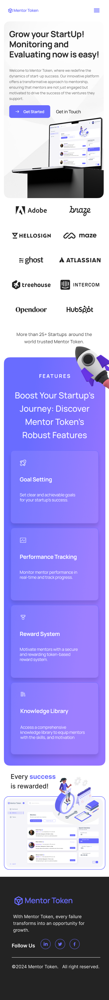
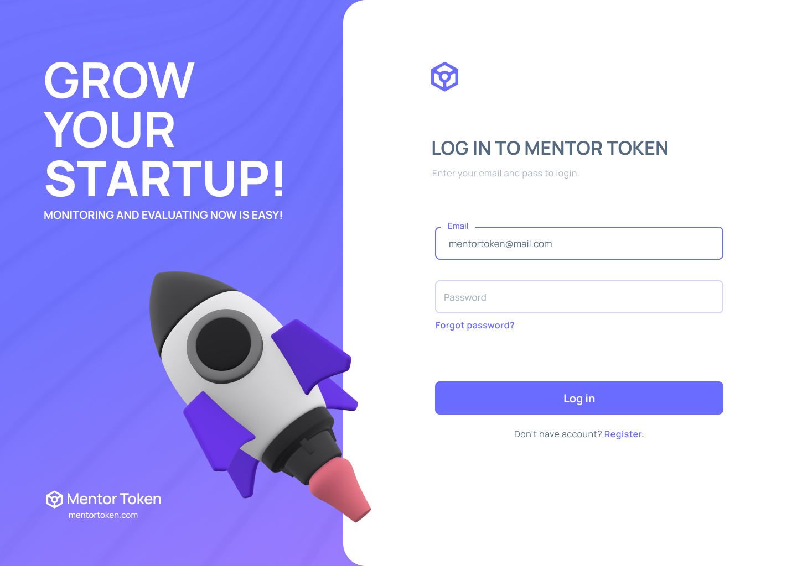
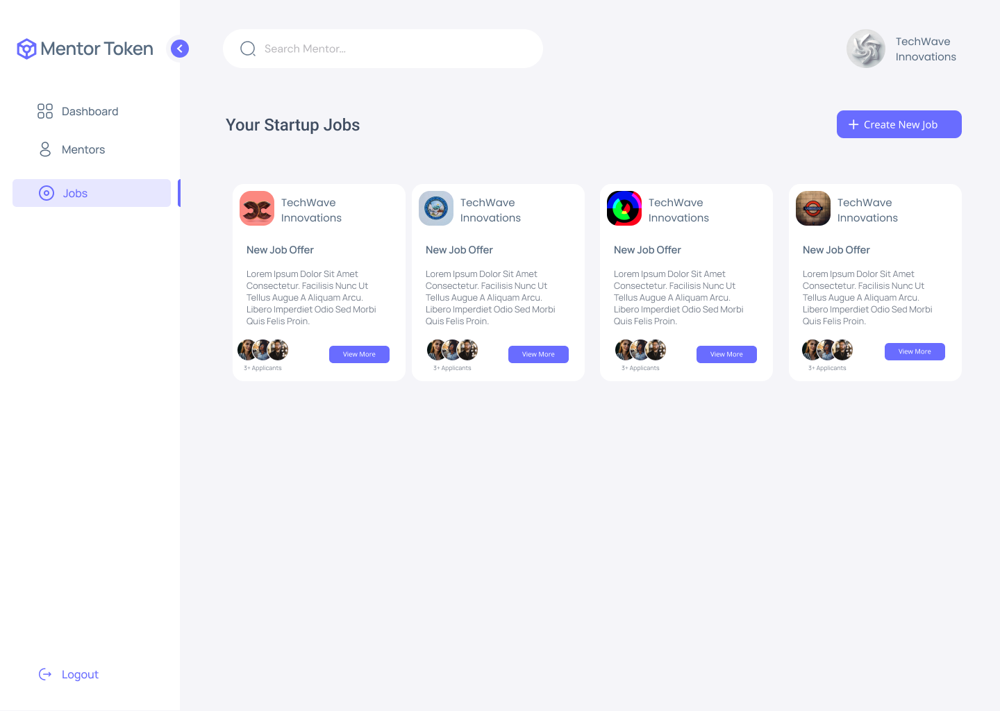

# Startup & Mentor Hub Platform

A feature-rich Full-Stack MERN (MongoDB, Express.js, React, Node.js) platform designed to bridge startups and skilled mentors. The application provides dynamic user dashboards, role-based controls, statistics tracking, and full CRUD operations for posting and applying to opportunities.

---

## 🌐 Public Pages
* **Home Page:** Overview of the platform's vision and core benefits.
* **About Us:** Information about the mission to empower startups and mentors.
* **Contact Us:** Interactive contact page for inquiries and support.
* **Navigation Header:** Quick access to navigation links, **Sign In**, and **Sign Up**.

---

## 🔐 Key Features & Functionality

### 👤 Authentication & User Profiles
* **Persistent Authentication:** Session retention keeps users signed in across visits (JWT / Session state).
* **Profile Customization:** Profile picture/avatar upload and dynamic user status management.

---

### 👨‍🏫 Mentor Experience
1. **Overview & Analytics Dashboard:**
   * Statistical summary tables tracking personal application metrics and completed tasks.
   * Overview of historical projects and activity logs.
2. **Opportunities & Applications:**
   * Browse available positions with integrated **Search and Filter** functionality (by name, keyword, or category).
   * Detailed Job View modal/page displaying comprehensive criteria.
   * One-click **Apply** button for open roles.
3. **Application Tracking:** Dedicated view to trace active submissions, accepted proposals, and finished engagements.

---

### 🚀 Startup Experience
1. **Analytics & Performance Dashboard:**
   * Top Mentors ranking list sorted algorithmically by completed job metrics.
   * High-level statistical summary tables tracking company stats and hire history.
2. **Mentor Discovery & Hiring:**
   * Browse verified mentor profiles and view their completed work volume.
   * Send direct work offers to preferred mentors.
3. **Job Management (Full CRUD):**
   * **Create:** Post new hiring or mentorship opportunities.
   * **Read:** View active job postings and submitted candidate applications.
   * **Update:** Edit terms, requirements, or listing status.
   * **Delete:** Remove outdated or filled job postings.

---

## 🛠️ Tech Stack

* **Frontend:** React.js, Custom CSS / UI Components, JavaScript (ES6+)
* **Backend:** Node.js, Express.js
* **Database:** MongoDB & Mongoose ORM
* **Authentication:** JWT (JSON Web Tokens) / Local Storage session tracking
* **Architecture:** RESTful API with Role-Based Access Control (RBAC)
* **Version Control:** Git & GitHub

---

## ⚙️ Local Setup Guide

1. **Clone the repository:**
   ```bash
2. **Install Server Dependencies:**
   npm install
3. **Install Client Dependencies:**
   cd client
   npm install
4.**Start Application:**
   npm run start
  # or: node server.js / nodemon server.js

## Screenshots

The following screenshots showcase the user interface and key features of the Startup & Mentor Hub Platform.

### Home Page

The landing page introduces the platform and provides navigation to its main sections.



### Login Page

The login interface allows users to access their accounts.



### Jobs & Opportunities

Users can browse available opportunities and explore job listings.



### Job Details & Application

Users can view the details of a job opportunity and proceed with the application process.


